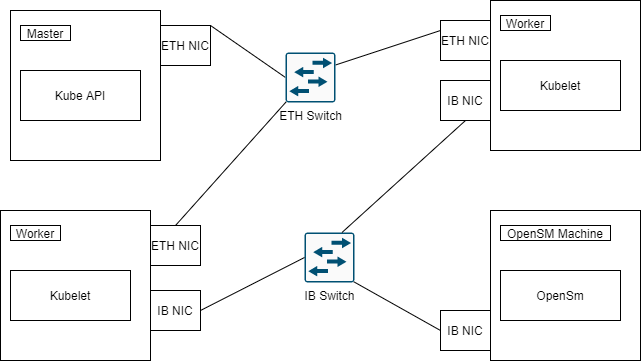

[](http://www.apache.org/licenses/LICENSE-2.0)
[](https://goreportcard.com/report/github.com/k8snetworkplumbingwg/ib-sriov-cni)
[](https://api.travis-ci.org/k8snetworkplumbingwg/ib-sriov-cni.svg?branch=master)
[](https://coveralls.io/github/k8snetworkplumbingwg/ib-sriov-cni)

   * [InfiniBand SR-IOV CNI plugin](#infiniband-sr-iov-cni-plugin)
      * [Build](#build)
      * [Enable SR-IOV](#enable-sr-iov)
         * [Using Upstream Mstflint](#using-upstream-mstflint)
         * [Using Mellanox OFED](#using-mellanox-ofed)
      * [Configuration reference](#configuration-reference)
      * [Usage](#usage)
      * [SR-IOV Network Operator](#sr-iov-network-operator)
      * [System Requirements and Topology](#system-requirements-and-topology)

# InfiniBand SR-IOV CNI plugin
NIC with [SR-IOV](http://blog.scottlowe.org/2009/12/02/what-is-sr-iov/) capabilities work by introducing the idea of physical functions (PFs) and virtual functions (VFs). 

A PF is used by host and VF configurations are applied through the PF. Each VF can be treated as a separate physical NIC and assigned to one container.

## Build

To build the plugin binary:

```
# make
```

Upon successful build the plugin binary will be available in `build/ib-sriov`.

## Enable SR-IOV

IB-SRIOV-CNI support Mellanox ConnectX®-4/ConnectX®-5/ConnectX®-6 adapter cards.

### Using Upstream Mstflint

To enable SR-IOV functionality using upstream mstflint, the following steps are required:

Install Mstflint package.
```
# yum install -y mstflint

```

Enable SR-IOV
```
# lspci | grep Mellanox
02:00.0 Infiniband controller: Mellanox Technologies MT27700 Family [ConnectX-4]
02:00.1 Infiniband controller: Mellanox Technologies MT27700 Family [ConnectX-4]

# mstconfig -d 0000:02:00.0 set SRIOV_EN=1 NUM_OF_VFS=8

Device #1:
----------

Device type:    ConnectX5       
Name:           MCX556A-ECA_Ax  
Description:    ConnectX-5 VPI adapter card; EDR IB (100Gb/s) and 100GbE; dual-port QSFP28; PCIe3.0 x16; tall bracket; ROHS R6
Device:         0000:02:00.0    

Configurations:                              Next Boot       New
         SRIOV_EN                            False(0)       True(1)         
         NUM_OF_VFS                          0              8               

 Apply new Configuration? (y/n) [n] : y
Applying... Done!
-I- Please reboot machine to load new configurations.

```

Reboot the machine
```
# reboot
```

Create SR-IOV VFs

```
# echo 4 > /sys/class/net/ib0/device/sriov_numvfs

# lspci | grep Mellanox
02:00.0 Infiniband controller: Mellanox Technologies MT27700 Family [ConnectX-4]
02:00.1 Infiniband controller: Mellanox Technologies MT27700 Family [ConnectX-4]
02:00.2 Infiniband controller: Mellanox Technologies MT27700 Family [ConnectX-4 Virtual Function]
02:00.3 Infiniband controller: Mellanox Technologies MT27700 Family [ConnectX-4 Virtual Function]
02:00.4 Infiniband controller: Mellanox Technologies MT27700 Family [ConnectX-4 Virtual Function]
02:00.5 Infiniband controller: Mellanox Technologies MT27700 Family [ConnectX-4 Virtual Function]

# ip link show
...
ib2: <BROADCAST,MULTICAST> mtu 1500 qdisc noop state DOWN mode DEFAULT group default qlen 1000
    link/infiniband c6:6d:7d:dd:2a:d5 brd ff:ff:ff:ff:ff:ff
ib3: <BROADCAST,MULTICAST> mtu 1500 qdisc noop state DOWN mode DEFAULT group default qlen 1000
    link/infiniband 42:3e:07:68:da:fb brd ff:ff:ff:ff:ff:ff
ib4: <BROADCAST,MULTICAST> mtu 1500 qdisc noop state DOWN mode DEFAULT group default qlen 1000
    link/infiniband 42:68:f2:aa:c2:27 brd ff:ff:ff:ff:ff:ff
ib5: <BROADCAST,MULTICAST> mtu 1500 qdisc noop state DOWN mode DEFAULT group default qlen 1000
...
```

To change the number of VFs reset the number to 0 then set the needed number

```
echo 0 > /sys/class/net/ib0/device/sriov_numvfs
echo 8 > /sys/class/net/ib0/device/sriov_numvfs
```

### Using Mellanox OFED

To enable SR-IOV functionality using Mellnaox's OFED, the following steps are required:

1- Enable SR-IOV in the NIC's Firmware.

> Installing Mellanox Management Tools (MFT) or mstflint is a pre-requisite, MFT can be downloaded from [here](http://www.mellanox.com/page/management_tools), mstflint package available in the various distros and can be downloaded from [here](https://github.com/Mellanox/mstflint).

Use Mellanox Firmware Tools package to enable and configure SR-IOV in firmware

```
# mst start
Starting MST (Mellanox Software Tools) driver set
Loading MST PCI module - Success
Loading MST PCI configuration module - Success
Create devices
```

Locate the HCA device on the desired PCI slot

```
# mst status
MST modules:
------------
    MST PCI module loaded
    MST PCI configuration module loaded
MST devices:
------------
/dev/mst/mt4115_pciconf0         - PCI configuration cycles access.
...
```

Enable SR-IOV

```
# mlxconfig -d /dev/mst/mt4115_pciconf0 set SRIOV_EN=1 NUM_OF_VFS=8
...
Apply new Configuration? ? (y/n) [n] : y
Applying... Done!
-I- Please reboot machine to load new configurations.
```

Reboot the machine
```
# reboot
```

2- Enable SR-IOV in the NIC's Driver.

```
# ibdev2netdev
mlx5_0 port 1 ==> ib0 (Up)
mlx5_1 port 1 ==> ib1 (Down)

# echo 4 > /sys/class/net/ib0/device/sriov_numvfs
# ibdev2netdev -v
0000:02:00.0 mlx5_0 (MT4115 - MT1523X04353) CX456A - ConnectX-4 QSFP fw 12.23.1020 port 1 (ACTIVE) ==> ib0 (Up)
0000:02:00.1 mlx5_1 (MT4115 - MT1523X04353) CX456A - ConnectX-4 QSFP fw 12.23.1020 port 1 (ACTIVE) ==> ib1 (Down)
0000:02:00.5 mlx5_2 (MT4116 - NA)  fw 12.23.1020 port 1 (DOWN  ) ==> ib2 (Down)
0000:02:00.6 mlx5_3 (MT4116 - NA)  fw 12.23.1020 port 1 (DOWN  ) ==> ib3 (Down)
0000:02:00.7 mlx5_4 (MT4116 - NA)  fw 12.23.1020 port 1 (DOWN  ) ==> ib4 (Down)
0000:02:00.2 mlx5_5 (MT4116 - NA)  fw 12.23.1020 port 1 (DOWN  ) ==> ib5 (Down)

# lspci | grep Mellanox
02:00.0 Infiniband controller: Mellanox Technologies MT27700 Family [ConnectX-4]
02:00.1 Infiniband controller: Mellanox Technologies MT27700 Family [ConnectX-4]
02:00.2 Infiniband controller: Mellanox Technologies MT27700 Family [ConnectX-4 Virtual Function]
02:00.3 Infiniband controller: Mellanox Technologies MT27700 Family [ConnectX-4 Virtual Function]
02:00.4 Infiniband controller: Mellanox Technologies MT27700 Family [ConnectX-4 Virtual Function]
02:00.5 Infiniband controller: Mellanox Technologies MT27700 Family [ConnectX-4 Virtual Function]

# ip link show
...
ib2: <BROADCAST,MULTICAST> mtu 1500 qdisc noop state DOWN mode DEFAULT group default qlen 1000
    link/infiniband c6:6d:7d:dd:2a:d5 brd ff:ff:ff:ff:ff:ff
ib3: <BROADCAST,MULTICAST> mtu 1500 qdisc noop state DOWN mode DEFAULT group default qlen 1000
    link/infiniband 42:3e:07:68:da:fb brd ff:ff:ff:ff:ff:ff
ib4: <BROADCAST,MULTICAST> mtu 1500 qdisc noop state DOWN mode DEFAULT group default qlen 1000
    link/infiniband 42:68:f2:aa:c2:27 brd ff:ff:ff:ff:ff:ff
ib5: <BROADCAST,MULTICAST> mtu 1500 qdisc noop state DOWN mode DEFAULT group default qlen 1000
...
```

To change the number of VFs reset the number to 0 then set the needed number

```
echo 0 > /sys/class/net/ib0/device/sriov_numvfs
echo 8 > /sys/class/net/ib0/device/sriov_numvfs
```

## Configuration reference

* `name` (string, required): the name of the network
* `type` (string, required): "ib-sriov"
* `deviceID` (string, required): A valid pci address of an InfiniBand SR-IOV NIC's VF. e.g. "0000:03:02.3"
* `guid` (string, optional): InfiniBand Guid for VF.
* `pkey` (string, optional): InfiniBand pkey for VF, this field is used by [ib-kubernetes](https://www.github.com/Mellanox/ib-kubernetes) to add pkey with guid to InfiniBand subnet manager client e.g. [Mellanox UFM](https://www.mellanox.com/products/management-software/ufm), [OpenSM](https://docs.mellanox.com/display/MLNXOFEDv461000/OpenSM).
* `ipam` (dictionary, optional): IPAM configuration to be used for this network, `dhcp` is not supported.
* `link_state` (string, optional): Enforces link state for the VF. Allowed values: auto, enable, disable.
* `rdmaIsolation` (boolean, optional): Enable RDMA network namespace isolation for RDMA workloads. More information
about the system requirements to support this mode of operation can be found [here](https://github.com/Mellanox/rdma-cni)
* `ibKubernetesEnabled` (bool, optional): Enforces ib-sriov-cni to work with [ib-kubernetes](https://www.github.com/Mellanox/ib-kubernetes).
* `vfioPciMode` (boolean, optional): Enable VFIO mode for devices (VF or PF) bound to vfio-pci driver. When enabled, the CNI skips network interface configuration as VFIO devices are used for direct device assignment (e.g., for kubevirt/VM workloads). Defaults to false. If not explicitly set, the mode is auto-detected based on the device's driver binding.
* `publishPfGuid` (boolean, optional): With `ibKubernetesEnabled: true` and an allocated PF bound to `vfio-pci`, publish this delegate's allocation in the `v1.ib-sriov-cni.io/connection-details` Pod annotation and wait for ib-kubernetes to report it `Ready`, instead of consulting `mellanox.infiniband.app=configured`. ADD fails if it does not become ready within `readinessTimeoutSeconds`. Publication failures fail ADD. Defaults to false; legacy readiness and VF GUID behavior remain unchanged outside this mode. Requires Kubernetes API access (see `kubeconfig`). ADD now succeeds only after ib-kubernetes reports the attachment `Ready`, so success means the controller confirmed the binding; consumers must support the structured schema below.
* `kubeconfig` (string, optional): Path to a kubeconfig the CNI uses to `get`/`patch` the pod when `publishPfGuid` is enabled. Generate one per node from the DaemonSet ServiceAccount with `ib-sriov --daemon --gen-kubeconfig` (or `thin_entrypoint --gen-kubeconfig` without the daemon), which writes `<cni-conf-dir>/ib-sriov-cni.d/ib-sriov-cni.kubeconfig` (`/etc/cni/net.d/ib-sriov-cni.d/ib-sriov-cni.kubeconfig` on the host with the reference DaemonSet, also the default when `kubeconfig` is omitted); that account needs RBAC to `get` and `patch` pods in the target namespaces. The manifests in `deployment/readiness/` grant this cluster-wide (a `ClusterRoleBinding`) because tenant pods may land in arbitrary namespaces. The standalone shape can be confined to known namespaces by binding the same `ClusterRole` with per-namespace `RoleBinding`s instead, since its `get` and `patch` are namespaced requests; the daemon shape cannot, because its informer lists and watches Pods across all namespaces (the node field selector is applied by the API server at the client's request and is not an RBAC boundary), and per-namespace grants leave that request unauthorized and the daemon unable to start.

* `readinessTimeoutSeconds` (integer, optional): Bounds the startup handshake. A publishing ADD waits for ib-kubernetes to report that attachment `Ready` in the `v1.ib-sriov-cni.io/connection-status` annotation and fails on timeout; a rollback DEL removes the entry it published, and a deleting Pod keeps its entries for the controller. This field only sizes that wait — it does not enable it, because publishing implies waiting. Unset means 120 seconds. Values above 3600 are capped to 3600.
* `logFile` (string, optional): Name of a node-local file, under `/var/log/ib-sriov-cni/plugin/`, that every plugin process on the node appends its log to. It is rotated when a process starts and finds it over `logFileMaxSize`; backups stay uncompressed and are pruned by count and age once they are old enough to be no running process's open file. Only the base name of the value is used: the definition names the file, the plugin owns the directory, so a namespaced definition author never chooses a host path (a value such as `/var/log/ib-sriov-cni.log` still works and lands as `/var/log/ib-sriov-cni/plugin/ib-sriov-cni.log`). The directory is the plugin's alone: the daemon writes its own file one level up and refuses to put it in here, so no definition can name the daemon's file and rotate it out from under the daemon's open descriptor. A CNI plugin is executed once per call and is not a pod, so the runtime discards its output on success and there is otherwise no record of what an ADD did. This applies to the process the runtime executes in both modes, **including** the one that only forwards to the daemon, because a forward can fail before the daemon ever sees it. The daemon itself keeps logging to its own output, where `kubectl logs` finds it. The file is written by a root host process, mode `0600`, and records pod namespace and name, PCI address and PF GUID, so read access to it is node-root access to that data. An existing entry under the directory that is not a regular file is refused rather than followed. Read it on the node: the plugin is not a container, and the shipped image is distroless with no shell. A configuration that fails to parse never reaches this file; that error travels back to the runtime instead.
* `logLevel` (string, optional): klog verbosity for that process, as a number such as `"4"`, not a name.
* `logFileMaxSize` / `logFileMaxBackups` / `logFileMaxAge` (integer, optional): rotation in megabytes, files kept and days; the plugin file's size is checked when a process starts, so a busy node can exceed it by what its running processes add, while the daemon's own file rotates in-process. Defaults 100, 3 and 7; values above 1024, 30 and 90 are reduced to those caps, because the definition is tenant input and the host's disk is the plugin's to protect. Rotation is not optional in practice: a validated image stays deployed, so this file is permanent.
The daemon keeps its own log separately, see [Node daemon](#node-daemon). Both
files are host-backed, which is why the plugin's directory is its own: a
definition cannot name the daemon's file.

* `daemonSocketPath` (string, optional): Overrides the socket this attachment is served through (see [Node daemon](#node-daemon)). Leave it unset: a publishing attachment (`ibKubernetesEnabled` with `publishPfGuid`) looks for the node daemon at `/run/ib-sriov-cni/ib-sriov.sock` and forwards when it is there, running the command in its own process when it is not, so deploying the daemon is enough to route through it and generated network definitions need no field. Every other configuration runs in the plugin process whether or not a daemon is installed: installing the DaemonSet changes nothing for a network that never enabled the handshake. Set this only to send a publishing attachment to a daemon at another path. A discovered socket with no daemon behind it falls back to in-process service; a configured one does not.

### Node daemon

`ib-sriov --daemon` serves CNI commands for one node over a Unix socket. It
holds a single Pod informer restricted to its own node and answers Pod reads
from that cache, so on the healthy path a readiness wait costs the API server
no read: an ADD still writes its publication (one PATCH, more on a conflict),
confirms a no-op or a rejected write with a live read, and a wait re-reads
live when its last authoritative read is more than a few seconds old. Without
the daemon, each waiting ADD polls the API server directly, which does not
scale to many nodes each starting several attachments per workload. Only a publishing attachment ever reaches the daemon:
every other configuration runs in the plugin process whether or not a daemon is
installed, and the daemon refuses configurations whose ADD or DEL would exec a
delegate such as IPAM.

The daemon is the DaemonSet's only container, the way the ovn-kubernetes node
container installs its CNI binary and then runs. With
`--install-cni-bin-dir=/host/opt/cni/bin` it copies its own executable into
the host's CNI directory before it opens the socket, so the plugin the runtime
execs is never a different build from the daemon it forwards to; with
`--gen-kubeconfig` it writes the node-local kubeconfig under `--cni-conf-dir`
and refreshes it every ten minutes while serving. `thin_entrypoint` remains for
deployments without the daemon: it installs the binary, writes the same
kubeconfig, and sleeps.

Deployment shapes, all in `deployment/`: the stock `ib-sriov-cni-daemonset.yaml`
(installer only, no API access, unchanged), `readiness/ib-sriov-cni-standalone.yaml`
(installer plus node kubeconfig and `get`/`patch` on pods) and
`readiness/ib-sriov-cni-daemon.yaml` (the daemon, which also needs `list` and
`watch`). Apply exactly one. A cluster that never sets `publishPfGuid` keeps
the stock manifest.

Daemon flags: `--log-file`, `--log-file-max-size`, `--log-file-max-backups`
and `--log-file-max-age` give it a rotated node-local log beside the plugin's
(stdout is kept, so `kubectl logs` is unaffected); `--log-level` sets klog
verbosity, since `-v` is the plugin's version shorthand, and at 6 and above
client-go logs every API request the daemon makes; `--metrics-bind-address`
opens an optional Prometheus endpoint; `--max-in-flight` caps concurrent
requests. Every callback and every accepted request ends with one `CNI request
completed` log line carrying phase timings, readiness outcome and API call
counts; see [Observability](docs/readiness-handshake.md#observability) in the
handshake document.

How the handshake works end to end, what the controller must do, how retries
reuse a binding, how the daemon remembers GUIDs, and the compatibility matrix
are in [docs/readiness-handshake.md](docs/readiness-handshake.md), with the
privileges each shape needs and why under its
[Security considerations](docs/readiness-handshake.md#security-considerations).

> *__Note__*: PF passthrough is only supported in VFIO mode. When using a PF device, it must be bound to the vfio-pci driver and `vfioPciMode` must be enabled (or auto-detected). Moving a PF's InfiniBand interface into a pod network namespace is not supported.

> *__Note__*: If `rdmaIsolation` is set to _true_, [`rdma-cni`](https://github.com/Mellanox/rdma-cni) should not be used.

### PF connection details

Publication is the PF VFIO path with the flag on; all three must be set:

```json
{
  "cniVersion": "0.3.1",
  "name": "ib-pf",
  "type": "ib-sriov",
  "vfioPciMode": true,
  "ibKubernetesEnabled": true,
  "publishPfGuid": true
}
```

With publication enabled, each ADD merges one member keyed by
`<NAD namespace>/<NAD name>/<PCI BDF>`. Repeated attachments of the same NAD
remain distinct because each allocated BDF has its own key:

```json
{
  "tenant-a/ib-pf/0000:03:00.0": {
    "nameSpace": "tenant-a",
    "networkName": "ib-pf",
    "deviceID": "0000:03:00.0",
    "pfGuid": "e0:9d:73:03:00:fe:b0:a4",
    "deviceIndex": 0
  }
}
```

`deviceIndex` is the node-local rank among InfiniBand PCI functions in sorted
BDF order, not a physical slot. The NAD identity comes from the Pod's Multus
networks selection: a selection that names its interface is matched on
`CNI_IFNAME` (KubeVirt always names them). A selection without one is named
by Multus from its position among every delegate, including default networks
the Pod annotation never mentions, so the position is not used; instead the
configuration's `name`, which the definition's owner wrote and Multus passes
with every invocation, is matched against the selections that carry no
interface. The bare form `ns/net-a,ns/net-a` therefore works. ADD fails and
asks for explicit interfaces only when that leaves more than one definition,
such as the same name selected from two namespaces, or none. Pod
namespace/name and optional UID come from `CNI_ARGS`. Ambiguous selection,
UID mismatch, invalid existing data, hardware read failure, and API errors
fail ADD. Concurrent publishers merge with resourceVersion conflict retries.
Legacy flat `deviceIndex -> GUID` annotations are not accepted in this mode.
DEL withdraws only the member this delegate published, fenced to the Pod it
published for by UID; the controller's status member and every sibling stay.
A DEL for a Pod that is itself being deleted withdraws nothing: the members
are the controller's record of what to release, and the Pod object takes them
with it. Only the sandbox that published may withdraw, and only while no later
sandbox of the same Pod has published the same function, so a late DEL for a
dead earlier sandbox cannot take the live sandbox's member away; the record
behind that rule is written before the publication and read under the same
node lock the publication takes. The full lifecycle, including rollback and
retry, is in
[docs/readiness-handshake.md](docs/readiness-handshake.md).

### Supported Capabilities / Runtime configurations

ib-sriov supports the following [CNI's Capabilities / Runtime Configuration](https://github.com/containernetworking/cni/blob/master/CONVENTIONS.md#dynamic-plugin-specific-fields-capabilities--runtime-configuration):

* `infinibandGUID` (string): Dynamically assign Infiniband GUID to network interface (VF).

## Usage

```
# cat > /etc/cni/net.d/10-ib-sriov.conf <<EOF
{
    "cniVersion": "0.3.1",
    "name": "mynet",
    "type": "ib-sriov",
    "deviceID": "0000:03:02.0",
    "link_state": "enable",
    "rdmaIsolation": true,
    "ibKubernetesEnabled": false,
    "ipam": {
                "type": "host-local",
                "subnet": "10.56.217.0/24",
                "rangeStart": "10.56.217.171",
                "rangeEnd": "10.56.217.181",
                "routes": [
                        { "dst": "0.0.0.0/0" }
                ],
                "gateway": "10.56.217.1"
        }
}

EOF
```
# SR-IOV Network Operator
[SR-IOV Network Operator](https://github.com/openshift/sriov-network-operator) is used to manage the SR-IOV interfaces on the nodes e.g. change the number of VFs on the node, it is also used to change the link type for the interfaces ETH to IB and vice versa, the [network policy example](https://github.com/openshift/sriov-network-operator/blob/master/deploy/crds/sriovnetwork.openshift.io_v1_sriovnetworknodepolicy_cr.yaml#L38) shows how to use the operator to change the link type and SR-IOV attributes for a given PCI physical function address.

# System Requirements and Topology
InfiniBand SR-IOV CNI works with kernel 5.6 which supports RDMA network namespace isolation and get/set of a VF's port and node GUID.

The recommended network topology for a Kubernetes deployment with Infiniband as a secondary network is as follows:
* Two physical networks, one Ethernet network used as Kubernetes management and Pod primary network (these can be separate) and another Infiniband network interconnecting Kubernetes worker nodes.
* Worker nodes where ib-sriov CNI is invoked are expected to have connectivity through the infiniband fabric with the subnet manager (SM), either running on a managed Infiniband switch or another node (i.e there needs to be an active SM in the fabric).



## Notes:
* OpenSM with SR-IOV support should be download form [Mellanox OFED](https://www.mellanox.com/products/infiniband-drivers/linux/mlnx_ofed).
